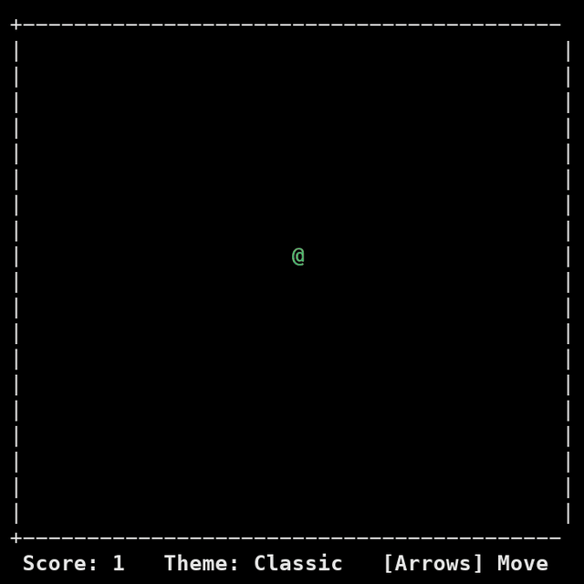

# dodgegame

**한 번 누를 때마다 한 턴씩 진행되는 터미널 회피 게임.** 사방에서 직선으로 날아오는 장애물을 미리 보고 피하며 얼마나 오래 버티는지 겨룹니다.

```sh
git clone https://github.com/tinkerer0/dodgegame.git
cd dodgegame
python3 dodgegame.py
```



방향키로 한 칸 움직이면 장애물도 한 칸 움직입니다. 각 장애물의 다음 위치가 흐린 `·`로 미리 보이고, 턴이 지날수록 장애물이 더 자주, 더 많이 나옵니다. 벽 쪽으로 움직이면 제자리에 머문 채 턴이 넘어갑니다. `/`로 색 테마 10종과 나·적 모양을 바꾸고, `r`로 다시 시작, `q`로 끝냅니다.

Python 3만 있으면 되고 설치할 패키지는 없습니다. Windows에서는 먼저 `pip install windows-curses`가 필요합니다. 터미널은 24열 × 12행 이상이어야 합니다.

화면 없이 판정 로직만 확인하려면 `python3 dodgegame.py --selftest`를 실행합니다.

## Feedback

제가 이런 분야를 접한 지 얼마 안 돼서 부족한 점이 많습니다. 고칠 점이나 알려주실 내용이 있다면 issue나 PR로 남겨주시면 너무 감사하겠습니다.

I am still new to this, so there is a lot to improve. Issues and pull requests with fixes or suggestions are very welcome.

## License

[MIT](LICENSE)
